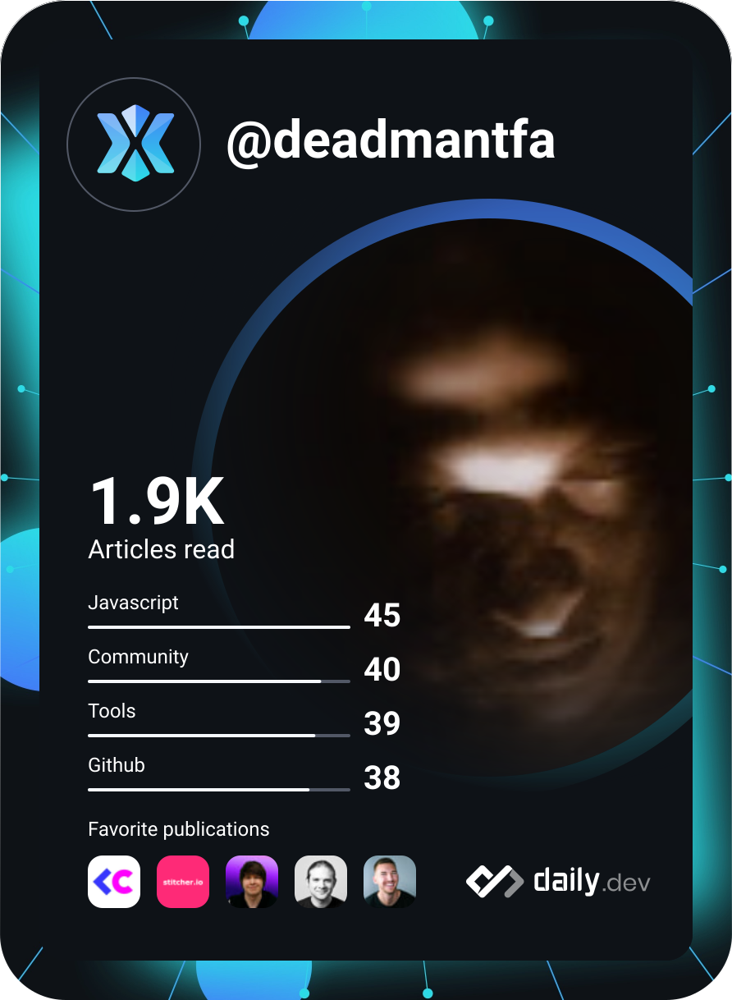

<h1 align="center">Hi 👋, I'm Wenceslaus Dsilva</h1>
<h3 align="center">CTO | Software Architect | 20+ Years of Technology Leadership</h3>

 
   

---

## 🚀 Professional Summary
Directed technology strategy and innovation, implementing AI solutions and modern architectures to drive project success and operational efficiency. Expert in scaling platforms and leading high-performance engineering cultures.

---

## 🛠️ Technical Arsenal
**Infrastructure:** AWS, Serverless, DevOps, Elasticsearch, Shell Scripting, PCI DSS, MySQL, SageMaker, Docker, Kubernetes, Redis, PostgreSQL  
**Backend:** Python, PHP, TypeScript, Yii Framework, Laravel, WebSockets, Node.js  
**Frontend:** React, Three.js, Next.js, Angular, Flutter  
**Leadership:** Leadership, AI Strategy, Design Thinking, Team Building, Critical Thinking

---

## 💼 Architectural Journey
### Rooftop
**Chief Technology Officer** (2022 - Present)

Directed technology strategy and innovation, implementing AI solutions and modern architectures (e.g., serverless) to drive project success and operational efficiency.

- Reduced system runtime by 85%
- Increased user engagement by 60%
- Boosting customer satisfaction rates by 90%
- Integrated secure payment gateways and expanded application capabilities

---

### Food Darzee (3CAD Hospitality LLP)
**Chief Technology Officer** (2019 - 2021)

Spearheaded the creation of new product verticals and ERP systems, automating processes and enhancing operational efficiency by 75%.

- Led multiple teams, both in-house and outsourced
- Integrated DevOps using GitHub Actions
- Integrated PayTM, PhonePe, and Axis Bank gateways
- Automated end-to-end supply chain via custom ERP

---

### EasyTech Innovations
**Chief Technology Officer** (2019)

Handled client delivery for multiple ERP systems and managed the SAAS product OnFees.

- Enhanced user satisfaction by 100% (OnFees)
- Improved project success rates by 60%
- Streamlined management and delivery issues for multi-tenant SAAS

---

### IndieFolio Network
**Chief Technology Officer** (2015 - 2018)

Architected and maintained 20+ online properties without downtime, enhancing system reliability and performance.

- Created serverless image handler (AWS Lambda)
- Architected Creative Field CQ algorithm for user discovery
- Developed real-time messaging with WebSockets and RBAC
- Improved user satisfaction by 90%

---

### CouponDunia
**Sr. Web Developer** (2015)

Architected and developed CashBoss Android App and backend, enhancing user engagement and operational efficiency.

- Implemented Restful APIs for Android
- Developed Yii2 based backend
- Streamlined processes and boosting productivity

---

### ePaisa Services
**Software Architect** (2013 - 2014)

Managed and designed web and mobile applications, ensuring PCI DSS compliance and optimal performance.

- Architected Voodle: AWS-based Blender render farm
- Implemented Dugna Security (MFA) for payment integrity
- Aligned technology with market trends

---

### MADAR International School
**Computer Programmer** (2009 - 2012)

Developed and maintained school management systems using Yii framework, enhancing system reliability.

- Created scripts to configure servers and publish code
- Automated deployment processes across servers
- Improved deployment efficiency

---

### Tata Consultancy Services
**Analyst Programmer** (2008 - 2009)

Delivered analyzed data using Quantum, SPSS, and other tools, enhancing data-driven decision-making.

- Automated market questionnaire analysis via Shell Scripts
- Automated data analysis processes
- Reducing manual effort

---

### WNS
**Analyst Programmer** (2007 - 2008)

Conducted data analysis using Quantum and SPSS, enhancing data-driven decision-making and improving project outcomes.

- Automated repetitive tasks using Shell Scripts
- Demonstrating strong project management skills

---

### WNS
**Junior Analyst** (2006 - 2007)

Worked on Data Analysis using Quantum, SPSS and other tools.

- Earned highest productivity hours award
- Effectively managing multiple projects simultaneously

---

## 🏗️ Featured Projects
### Architecting for Exponential Growth
**Company:** Rooftop | **Period:** 2022 - Present

**Impact:** Reduced system runtime by 85% and increased user engagement by 60% through modern serverless architectures and AI solutions. Established sustainable cloud cost savings of 40% YoY while maintaining 99.9% uptime SLA.

**Tech Stack:** `AWS` `Serverless` `AI/ML` `SageMaker` `Next.js` `DevOps`

---

### ERP Modernization & Vertical Growth
**Company:** Food Darzee | **Period:** 2019 - 2021

**Impact:** Improved operational efficiency by 75% through custom ERP systems and seamless third-party integrations. Reduced data entry errors by 90% and enabled company scaling from 1,000 to 10,000+ daily active subscribers.

**Tech Stack:** `PHP` `Yii` `GitHub Actions` `Payment Gateways` `ERP`

---

### SAAS Transformation for Education
**Company:** EasyTech Innovations | **Period:** 2019

**Impact:** Achieved 100% enhancement in user satisfaction by streamlining the student onboarding and payment experience. Processed over $50M in transactions in first year with zero security incidents and 99.99% payment gateway uptime.

**Tech Stack:** `SAAS` `Cloud Architecture` `Payment Systems` `Node.js`

---

### Architecting a Creative Ecosystem
**Company:** IndieFolio Network | **Period:** 2015 - 2018

**Impact:** Established a highly reliable, serverless-first architecture that supported 100,000+ creatives with hyper-personalized discovery tools. Achieved 100% platform uptime across 3 years and pioneered color-based search enabling first-of-its-kind discovery experience.

**Tech Stack:** `AWS` `Serverless` `Elasticsearch` `WebSockets` `PHP` `Nginx`

---

### High-Integrity Payment Architecture
**Company:** ePaisa Services | **Period:** 2013 - 2014

**Impact:** Ensured 100% PCI DSS compliance while launching innovative mobile-first security and media features.

**Tech Stack:** `AWS` `EC2` `Blender` `PCI DSS` `PHP` `Node.js`

---

### Foundational Data Automation
**Company:** Tata Consultancy Services / WNS | **Period:** 2006 - 2009

**Impact:** Reduced manual data processing time by 90% through custom automation and earned "Highest Productivity" recognition. Established automation best practices that became organizational standard, reducing error rates from 15% to 0.2%.

**Tech Stack:** `Shell Scripting` `Quantum` `SPSS` `Linux`

---

### Scaling Mobile Engagement
**Company:** CouponDunia | **Period:** 2015

**Impact:** Successfully launched the CashBoss Android ecosystem, driving a 40% increase in mobile-led user conversions.

**Tech Stack:** `Yii` `PHP` `RESTful APIs` `MySQL`

---

<h3 align="left">Connect with me:</h3>

<h3 align="left">Support:</h3>

&nbsp;

|  |  |  |
| --- | --- | --- |

|  |  |  |
| --- | --- | --- |

| 

 | </img> |
| --- | --- |